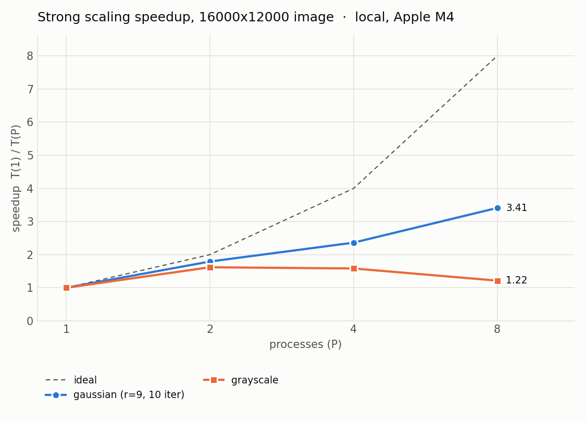
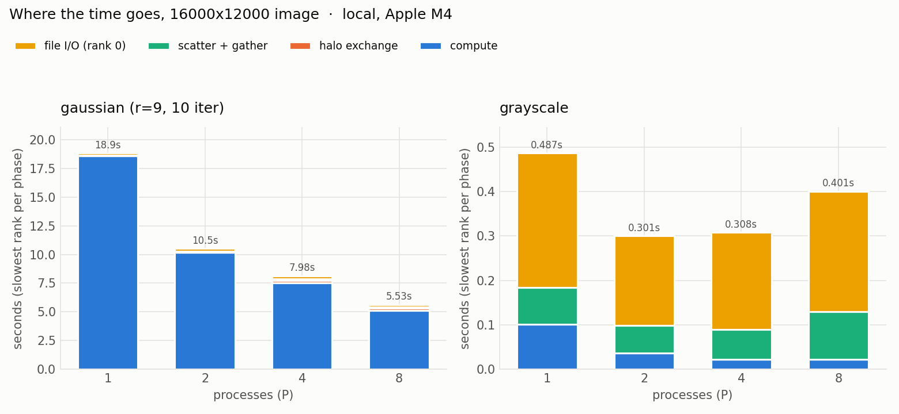
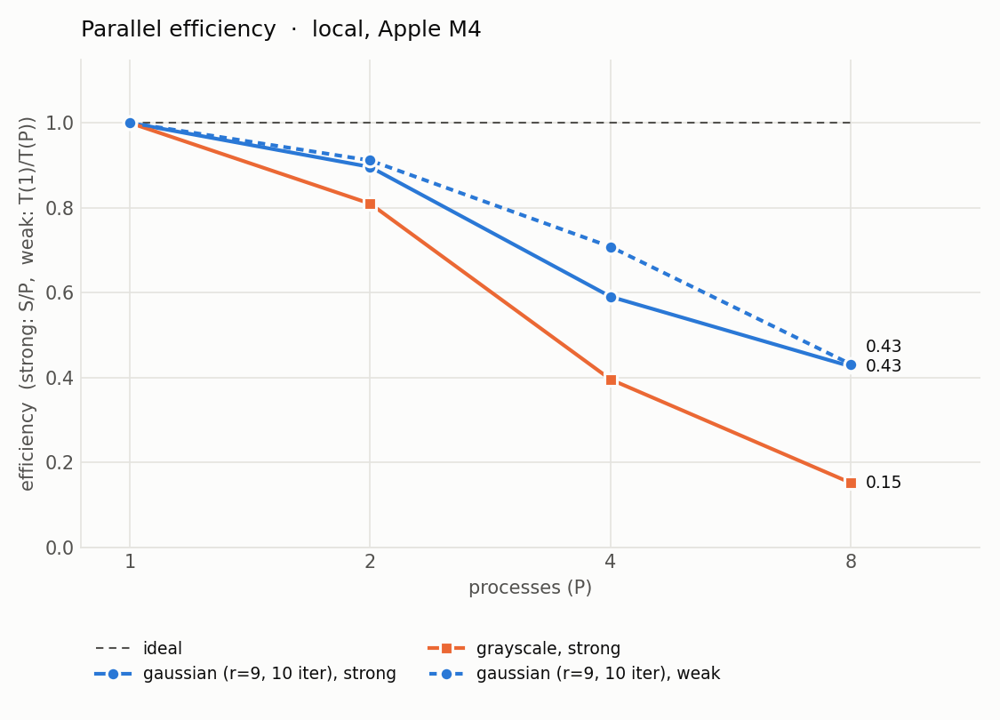

# Parallel Image Filters with OpenMPI

A C11 program that applies image filters (grayscale, box blur, Gaussian blur, Sobel edge detection) to large uncompressed BMP images, parallelized with **OpenMPI** using row-band domain decomposition and halo (ghost-row) exchange.

The MPI build produces output that is **byte-for-byte identical** to a serial baseline for every filter, image size and process count tested. A 750-check test suite verifies this, and it also runs cleanly under AddressSanitizer.



## Highlights

- **Everything from scratch.** BMP reader/writer with no image libraries: row padding, bottom-up and top-down storage, BGR order, and strict header validation.
- **Row-band decomposition.** Bands are distributed with `MPI_Scatterv`/`MPI_Gatherv` using a derived *row* datatype, so every count is in rows, not bytes, and images over 2 GB don't overflow `int` counts.
- **Halo exchange** with paired `MPI_Sendrecv` calls and `MPI_PROC_NULL` at the image edges, so there is no special-case code for the first and last ranks.
- **One set of kernels, two builds.** `filters.c` contains zero MPI calls; the serial and MPI drivers run the exact same per-pixel arithmetic. That is what makes the byte-identical check meaningful.
- **Iterated filters stay distributed.** With `-n N`, data never leaves the ranks between iterations; only halos move.
- **Fails cleanly.** Rank 0 validates everything and broadcasts an ok/abort flag, so every rank exits together on bad input, with no hangs. Every MPI call is checked and aborts all ranks on failure.
- **Instrumented.** Per-phase timings (read, scatter, compute, halo, gather, write, total) are reduced with `MPI_MAX` and appended to a CSV for the scaling plots.

## Filters

| Filter | What it does | Neighborhood | Halo rows |
|---|---|---|---|
| `grayscale` | Luminance `Y = 0.299R + 0.587G + 0.114B`, rounded, written to all 3 channels | none | 0 |
| `box` | Mean over a (2R+1)×(2R+1) window, per channel | `-r R` | R |
| `gaussian` | Separable Gaussian blur, float accumulation, rounded once at the end | `-s sigma` | ⌈3σ⌉ |
| `sobel` | Gradient magnitude on luminance, clamped to [0, 255] | 3×3 | 1 |

Image borders use clamp-to-edge: the first and last rows and columns are repeated outward.

## Quick start

**Requirements:** a C11 compiler, OpenMPI (`mpicc`, `mpirun`), and Python 3 with `numpy`, `Pillow` and `matplotlib` for the tooling.

```bash
# macOS:  brew install open-mpi        Debian/Ubuntu:  sudo apt install libopenmpi-dev openmpi-bin
make                      # builds bin/filter_serial and bin/filter_mpi (zero warnings)

python3 tools/gen_image.py 4000 3000 photo.bmp          # synthetic test image

mpirun -np 4 ./bin/filter_mpi -i photo.bmp -o blurred.bmp -f gaussian -s 3 -n 10
./bin/filter_serial          -i photo.bmp -o edges.bmp   -f sobel
```

### Command line

```
mpirun -np <P> ./bin/filter_mpi -i in.bmp -o out.bmp -f <grayscale|box|gaussian|sobel>
                                [-r radius] [-s sigma] [-n iterations] [--timing-csv file.csv]
./bin/filter_serial             (same flags, no mpirun)
```

| Flag | Meaning | Default |
|---|---|---|
| `-r` | box radius, 1 to 1000 | 1 |
| `-s` | Gaussian sigma, greater than 0 and at most 100 | 1.0 |
| `-n` | number of times to apply the filter | 1 |
| `--timing-csv` | append one row of phase timings to this CSV | off |

Each band must be at least as tall as the filter's halo. If too many processes are requested for the image height, the program says how many it can use:

```
error: 7 processes split 37 rows into bands of 5, but filter 'box' needs 6 halo rows per band; use at most 6 processes
```

## How it works

### Decomposition

Rank 0 reads the BMP and broadcasts the width, height and filter parameters. The rows are split into P contiguous bands. When P doesn't divide the height, the first `height % P` ranks get one extra row (10 rows over 4 ranks gives 3, 3, 2, 2). Bands go out with `MPI_Scatterv` and come back with `MPI_Gatherv`, using a datatype that is one image row (`MPI_Type_contiguous(width * 3, MPI_UNSIGNED_CHAR)`).

### Halo exchange

Blur and Sobel need rows that belong to neighboring ranks. Each rank stores its band with R extra rows above and below, where R is the filter radius, and refreshes them before every filter pass:

```
              image rows                        rank 1's buffer
           ┌──────────────┐
           │              │
  rank 0   │   band 0     │           ┌──────────────────────────┐
           │              │ ─ ─ ─ ─ ─►│ top halo   (R rows)      │ ◄─ last R rows of rank 0
           ├──────────────┤           ├──────────────────────────┤
           │              │           │                          │
  rank 1   │   band 1     │           │ owned rows               │ ── first R rows → rank 0
           │              │           │                          │ ── last R rows  → rank 2
           ├──────────────┤           ├──────────────────────────┤
           │              │ ─ ─ ─ ─ ─►│ bottom halo (R rows)     │ ◄─ first R rows of rank 2
  rank 2   │   band 2     │           └──────────────────────────┘
           │              │
           └──────────────┘
```

Two `MPI_Sendrecv` calls do the whole exchange: everyone sends up and receives from below, then everyone sends down and receives from above. Pairing each send with its receive means the exchange can't deadlock. The top and bottom ranks have `MPI_PROC_NULL` as their outside neighbor, so that half of the call does nothing. Those ranks then fill their outer halo by repeating their edge row, which is exactly the clamp-to-edge boundary. If any band were shorter than R, its halo would need rows from two ranks away, so the program refuses to run.

The kernels receive a pointer to the first owned row and read rows `-R … rows+R-1` around it. The serial build uses the same layout, treating the whole image as one band whose halos are always repeated edge rows. This is why one kernel implementation serves both builds.

### Keeping serial and MPI identical

Matching output byte for byte requires every pixel to be computed with the same operations in the same order, whichever rank owns it:

- **Grayscale and Sobel** use exact integer arithmetic (`(299R + 587G + 114B + 500) / 1000`), and Sobel's magnitude uses `sqrt` of an integer.
- **Box** uses exact integer sliding-window sums, so the order of additions can't matter.
- **Gaussian** weights are computed once in double, normalized, and stored as float. Every rank and the serial build use those same taps, always accumulating in the same order.
- The build uses `-ffp-contract=off`, which stops the compiler from fusing `a*b + c` into one instruction. Clang does that by default and GCC doesn't, so without the flag results could differ between compilers.

## Testing

```bash
make test           # full correctness suite (~80 s)
make test-debug     # the same suite against an AddressSanitizer build
```

`scripts/run_tests.sh` exits nonzero on any failure. From a clean checkout it runs 754 checks:

| What | How |
|---|---|
| BMP I/O | Read then write gives a byte-identical file at 1×1, 3×7, 101×37, 1023×769 and 4000×3000 (all four padding cases); Pillow-written files round-trip too; top-down files read correctly |
| Filters are correct | Serial output vs an independent NumPy reference (`tools/reference.py`) that decodes with Pillow and uses whole-array math, so it shares no code with the C kernels; exact for grayscale/box/Sobel, ±1 for Gaussian (float32 vs float64) |
| MPI equals serial | Every filter setting × every size × P ∈ {1, 2, 3, 4, 7} × 1 and 3 iterations must be **byte-identical** to serial, including uneven splits, ranks that own zero rows, and the tightest legal case (smallest band exactly equal to the halo) |
| Output is valid | Pillow opens every serial and MPI output file |
| Error paths | Non-BMP, 32-bit, truncated and compressed BMPs, missing files, unwritable output, bad arguments, and too many processes for the radius; each must fail with a clear message, and every `mpirun` is killed after 120 s so a hang counts as a failure |

To confirm the suite actually catches bugs, bugs were deliberately planted in copies of the code (an off-by-one in band offsets, a skipped halo exchange, halos capped at 3 rows, a wrong Gaussian edge clamp). Each one made the suite fail, and for the halo cap, only the filters whose halo is wider than 3 failed.

## Benchmarks

```bash
make && scripts/bench_local.sh      # strong + weak sweep, 3 repeats, then plots
```

Each configuration runs 3 times; the plots use the run with the median total time, so its phase times add up. Phase times are the slowest rank's time for that phase (`MPI_MAX`).

**Local results:** Apple M4 laptop (4 performance + 6 efficiency cores, 16 GB), OpenMPI 5.0.11. Strong scaling uses a 16000×12000 image (576 MB); weak scaling uses 2000 rows per process, 16000 pixels wide. The Gaussian runs use σ = 3 (radius 9) for 10 iterations.

| P | Gaussian total | speedup | Grayscale total | speedup | Weak-scaling total (same work per rank) |
|---|---|---|---|---|---|
| 1 | 18.85 s | 1.00 | 0.49 s | 1.00 | 3.45 s |
| 2 | 10.52 s | 1.79 | 0.30 s | 1.62 | 3.79 s |
| 4 | 7.98 s | 2.36 | 0.31 s | 1.58 | 4.87 s |
| 8 | 5.53 s | 3.41 | 0.40 s | 1.22 | 8.00 s |





What the data shows:

- **Grayscale is I/O-bound and barely scales.** The filter itself takes 0.1 s on one process; most of the time is rank 0 reading and writing the 576 MB file plus scatter/gather. It is fastest at P = 2 and gets slower beyond that, as communication overhead outgrows the shrinking compute.
- **Gaussian blur is compute-bound and does scale.** Compute is over 90% of the run time at every P, and the run is 3.4× faster on 8 processes.
- **Halo exchange is cheap.** It never exceeds 0.23 s, about 3% of the run, even at P = 8 with 9-row halos exchanged 10 times.
- **On this laptop, the scaling limit is the hardware, not MPI.** In the weak-scaling runs every rank does the same amount of work at every P, yet compute time per rank rose from 3.4 s to 7.1 s between P = 1 and P = 8, while halo time stayed small. Communication can't explain that. The likely causes are shared memory bandwidth (blurring streams a lot of data) and the M4's mixed cores: at P = 8, at least four ranks must run on slower efficiency cores, and the slowest rank sets the pace. The planned HiPerGator runs on identical server cores should separate these effects.

Raw data: [`results/final/local/`](results/final/local/) (CSV files and a summary table).

## Repository layout

```
include/        bmp.h  filters.h  decomp.h  timing.h  cli.h
src/
  main_mpi.c    MPI driver: validate on rank 0, broadcast, scatter, iterate, gather, write
  main_serial.c serial baseline (same CLI, same kernels)
  bmp.c         BMP read/write
  filters.c     pure pixel kernels, no MPI
  decomp.c      row partitioning, scatter/gather, halo exchange, MPI error checking
  timing.c      MPI_Wtime / clock_gettime timers and the CSV writer
  cli.c         argument parsing shared by both drivers
tools/
  gen_image.py      deterministic synthetic BMPs of any size (also 32-bit and top-down variants)
  compare.py        byte or pixel diff between BMPs; Pillow validation
  reference.py      independent NumPy implementation of every filter
  plot_scaling.py   speedup, efficiency and breakdown plots from the CSVs
scripts/
  run_tests.sh      correctness suite
  bench_local.sh    local scaling sweep
tests/images/   small fixtures (odd sizes, top-down, 32-bit, truncated, compressed, not-a-BMP)
results/final/  benchmark data and plots
```

## Design decisions

- **Gaussian halos carry the original 8-bit rows, not float intermediates.** The horizontal pass needs no halo, so one option is to run it first and exchange float rows for the vertical pass. Instead, ranks exchange the original 8-bit rows and redo the horizontal pass on the 2R halo rows. That sends a quarter of the bytes, keeps one row datatype for every filter, and needs one exchange per iteration. The redundant work is small: 2R rows per band.
- **Gaussian uses a rolling buffer.** The horizontal results live in a ring of 2R + 1 float rows instead of a full-image float buffer, which would be about 2.3 GB for a 16000×12000 image.
- **Barriers separate the timed phases**, so a slow phase on one rank isn't billed to the next phase. Halo time still includes waiting for a slower neighbor, which is load imbalance showing up honestly.
- **The `radius` CSV column is the effective radius**, meaning the halo rows: the box radius, ⌈3σ⌉ for Gaussian, 1 for Sobel, 0 for grayscale.
- **BITMAPV4/V5 headers are accepted** when the image is uncompressed 24-bit, since their pixel layout is the same as BITMAPINFOHEADER. Everything else (other bit depths, compression, OS/2 headers) is rejected with a specific message.

## Roadmap

- [x] BMP I/O, serial filters, MPI scatter/gather, halo exchange, all four filters in MPI
- [x] Correctness suite (byte-identical MPI vs serial, ASan)
- [x] Timing instrumentation, local benchmark sweep and plots
- [ ] SLURM job script and strong/weak scaling on UF HiPerGator (P up to 32)
- [ ] Parallel input with MPI-IO (`MPI_File_read_at_all`), compared against rank-0 read + scatter
